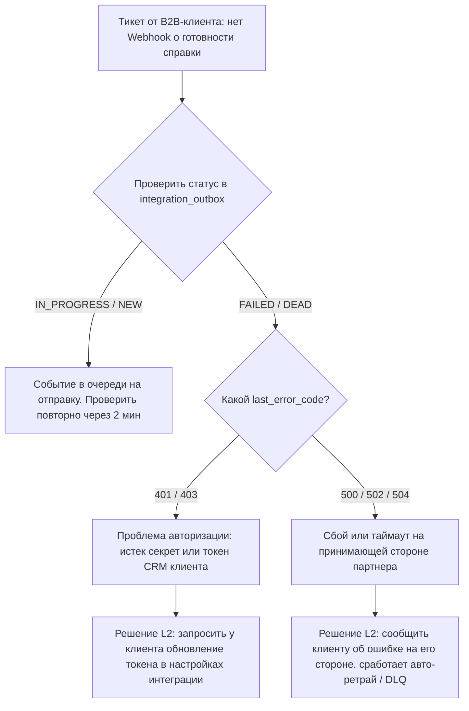

# Этап 3. Runbook L2: локализация инцидентов и траблшутинг

## 📌 Контекст
После обработки заявки (`POST /documents/process`) и наложения факсимиле сервис «Справки и выписки» отправляет партнеру Webhook-уведомление о готовности документа (`STATEMENT_READY` / `STATEMENT_FAILED`).

Когда клиент обращается в поддержку с жалобой *«заказали выписку, статус завис / не пришло уведомление в CRM»*, инженер L2 использует этот регламент, чтобы локализовать причину до эскалации в разработку.

---

## 🛠️ Алгоритм диагностики недоставки Webhook

### Шаг 1. Проверка статуса справки и очереди отправки в БД (PostgreSQL)
Все исходящие уведомления фиксируются по паттерну **Transactional Outbox**. Сначала проверяем статус самого документа и историю попыток отправки вебхука:

```sql
SELECT 
    o.id AS outbox_id,
    o.document_id,
    o.external_client_id,
    o.status AS webhook_status,
    o.retry_count,
    o.last_error_code,
    o.last_attempt_at,
    o.payload->>'eventType' AS event_type,
    o.payload->>'docType' AS doc_type
FROM integration_outbox o
WHERE o.status IN ('FAILED', 'DEAD')
  AND o.last_attempt_at >= NOW() - INTERVAL '4 hours'
ORDER BY o.last_attempt_at DESC
LIMIT 15;
```

*Дополнительно для проверки конкретной заявки по `documentId` из ответа API:*
```sql
SELECT id, external_id, doc_type, status, sign_id, updated_at
FROM documents
WHERE id = 'doc_987654321';
```

---

### Шаг 2. Анализ логов воркера отправки (Kubernetes / Grafana Loki)
Если в БД видна ошибка отправки или документ завис в `PROCESSING`, проверяем логи сервиса `webhook-dispatcher` или `document-service`:

```bash
kubectl logs -n integration -l app=webhook-dispatcher --tail=200 | grep -E "ERROR|TIMEOUT|doc_987654321"
```

**Типовые маркеры в логах:**
* `Connection refused` / `504 Gateway Timeout` — недоступен сервер принимающей стороны (CRM клиента) или внешнего сервиса подписания `SignSvc`.
* `401 Unauthorized` / `403 Forbidden` — просрочен токен или неверная подпись вебхука на стороне клиента.

---

### Шаг 3. Дерево решений (Decision Tree)



---

## 🔄 Политика повторных попыток (Retry Policy & DLQ)
* **Интервалы ретраев:** *Exponential Backoff* — `1 мин`, `5 мин`, `15 мин`, `1 час`.
* **Лимит:** максимум `5 попыток`.
* **DLQ (Dead Letter Queue):** если за 5 попыток принимающий сервер не вернул `200 OK`, событие переходит в статус `DEAD` и хранится 14 дней для ручного перезапуска после устранения сбоя у клиента.

---

## 🐞 Пример эскалации на L3 (шаблон баг-репорта в Jira)
Если проверка показала, что сбой произошел не у клиента, а внутри контура платформы (например, массовый `504` на внешнем сервисе подписания `SignSvc`), инженер L2 передает разработчикам полностью собранную фактуру:

> **Заголовок:** `[Prod/Stage][Document Service] Массовый таймаут 504 при обращении к SignSvc (POST /v1/signatures)`
> 
> **Контекст и затронутые заявки:** `documentId: doc_987654321`, `externalId: CRM-STMT-10928`, `X-Idempotency-Key: c9b2c8a1-6e3e-4b77-8f55-123456789abc`
> 
> **Что проверено на L2:**
> 1. Валидация запроса клиента пройдена (`docType: ACCOUNT_STATEMENT`, размер PDF Base64 в норме).
> 2. В таблице `documents` заявка перешла в статус `FAILED` (отсутствует `sign_id`).
> 3. В логах `document-service` фиксируется `Timeout / Connection Drop` после 5000 ms ожидания ответа от `SignSvc`.
> 
> **Ожидаемый результат:** `SignSvc` принимает заявку со статусом `202 Accepted` и возвращает `Sign ID`.  
> **Фактический результат:** клиент получает `504 Gateway Timeout` (RFC 7807).

---

## 🎯 Ценность регламента для команды поддержки
* **Четкое разделение ответственности:** L2 самостоятельно локализует ошибки на стороне клиента (`401/422`) и сбои принимающей CRM без привлечения разработчиков.
* **Качественные эскалации на L3:** если проблема на стороне бэкенда, в разработку уходит готовый тикет с `documentId`, состоянием БД и выдержкой из логов.
